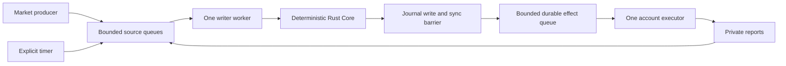

# Runtime v2 design decisions

Source investigation: `aee5a10` / baseline harness `da7a919`. This document implements the design scope of RV1 and RV4a; it does not extend the Rust Core to multiple instruments or change the journal's trust contract.

## ADR 1: Python asyncio coordination, one Rust writer

Choose Python asyncio for the first bounded runtime. The current strategies and adapter are Python, and Engine already provides process isolation and a durable single-writer contract. Rust I/O would require another protocol and driver rewrite before it could improve measured coordination. RV0 establishes that the serial reference queues work behind a fake adapter delay. This motivates separating execution, not moving Core or adding Tokio without evidence.

Native async adapters are preferred. `BlockingExecutor` provides one daemon worker for a synchronous adapter. Cancellation does not terminate its socket call: the worker remains busy, its late result is discarded, and its account cannot restart until the call is resolved or a venue-specific reconciliation barrier proves it cannot still mutate. There is never a replacement thread per timeout. Pure bounded SMA work and Engine calls run on one dedicated writer worker; arbitrary unbounded strategy callbacks are unsupported. Additional strategy plugins must provide a bounded worker and stale-result contract before admission.

Default bounds are frozen in `comparisons/runtime-v2/manifest.json`: 128 input slots / 1 MiB; one 64 KiB message; 32 reserved critical slots; 8 registered sources; 32 queued effects / 64 KiB; one active writer call and one active execution. One input slot and 1024 bytes are reserved for an internal Disconnect latch. The in-flight input/effect are separately bounded to one; counters distinguish queued versus in-flight. No unbounded futures, tasks or telemetry queue is created. Logs are streamed; latency retention is capped at 10,000 samples per metric and explicitly labelled as a rolling window.

## ADR 2: Admission order, fairness, overload

`Input` carries venue/account/instrument IDs, source, source epoch and optional source sequence, event time, local scheduled/receive times, correlation ID and schema version. The final engine sequence is assigned by the writer and recorded beside the raw input. Local private delivery sequence is not an exchange sequence. The existing Rust journal records its accepted Core inputs and time; the outer input trace is operational evidence, not a new authoritative journal schema.

Never bypass a source's head. Across sources serve at most four critical heads before one ready market head; critical includes control/private/timer, round-robin among sources. Critical arrivals are serviced before another market head, so the configured maximum market burst of eight is an upper bound rather than a batching target. Per-source sequence gaps or epoch changes latch recovery. Duplicate/old source sequences are refused conservatively; duplicate executions with a new delivery sequence still reach Core's exact fill deduplication.

No coalescing is enabled. A producer gets explicit admission refusal; a rejected market message is not an admitted event. A later native sequence gap forces recovery. Critical overflow latches Disconnect immediately, with its reserved slot; the Rust gate follows through the same writer. The host latch already stops dispatch and new known mutations while the writer is busy. Unsupported or oversized envelopes are refused; malformed Core inputs poison/stop the writer rather than dispatch effects.

Effect queue overflow is uncertainty, never rejection. Its durable intents remain in the journal and keep reservations. The current coordinator discards queued external effects, records their count, latches the gate, and reconciles before any replacement coordinator. It never resends those effects. This is conservative even for a queued cancel: risk remains reserved. Operator cancel/reconciliation can resume through a quiescent recovery path when connectivity permits. Timeout and executor cancellation do not claim absence.

Before dispatch, a writer-owned read guard may skip a cancel only when the order is confirmed terminal and not uncertain; this releases no reservation and records `effects_skipped_terminal`. A SendOrder requires the account logical clock and is gated if its intent expired while queued. Recheck the host latch after the guard; a refusal leaves the durable intent unresolved.

Shutdown stops new market/strategy admission, allows bounded critical reports while draining, and awaits the single executor with a finite deadline. Hard abort cancels tasks, preserves durable intents, and requires recovery. A coordinator latch is not automatically reset: stop it, resolve all old in-flight activity, reconcile with Core, then create a fresh coordinator. Core error stops both tasks. Disk sync can still block the writer; this is an intentional durability barrier, not adapter head-of-line blocking.

## ADR 3: Risk ownership and venue capabilities

Future identity is `(venue, account, instrument)`, not a globally unique symbol string. Decimal tick/lot configuration converts exactly to integer Core units. A registry rejects shared accounts assigned to separate risk domains and rejects unsupported amend/reduce-only before an intent is built. `comparisons/runtime-v2/venues.json` covers the existing Binance REST assumptions and two different fake venue contracts; it does not certify real exchange capabilities.

One writer owns each account risk domain; instruments sharing collateral stay together. Independent domain writers require explicit portfolio allocation/reservation before cross-domain trading. The current Core remains one Spot instrument with gross session inventory limits. `Registry.require_v0` rejects multi-instrument or margin operation. Fees and independent wallet balances remain adapter/reconciliation facts, not hidden changes to Core inventory. Perpetual fees/funding/margin/liquidation require a separate accounting and risk design.

Capabilities include native sequence, atomic snapshot, bounded/unknown history retention, proof of absence, client-ID limits, amend, reduce-only and account margin. `None` retention means unknown, not infinite. Hyperliquid nonce rules, Kraken reporting order and correction semantics must be supplied by their adapters; none is assumed from the fake fixtures.

## ADR 4: Journal, migration and recovery trust

Keep journal schema 1 and protocol 2. Add only optional trace output (`durable_seq`) and a Python `last_change` view; old consumers can ignore the trace field. No data migration is required, and the old binary can still inspect the same journals. Rolling back coordinator code requires first stopping writers/executors and resolving uncertainty; no old effects are resent.

Today recovery reads the entire journal, validates checksum/sequence and applies the complete prefix before matching the snapshot. Snapshot loading can grow with retained orders/fills. Rotation also scans its predecessor; paper rotation is not a live retirement proof. Startup is therefore O(journal bytes + replay work + retained state), and transient memory includes the input bytes. Venue reconciliation is a separate phase.

Three options were considered:

1. Full validation before trading: preserves current semantics, cannot avoid reading the archive.
2. Trust an atomically published checkpoint and seek to tail: faster, but old complete corruption may no longer fail startup. This weakens the current contract and is not authorized here.
3. Validate archives in the background: also weakens startup gating, and cannot be described as option 1.

RV4b fast startup and automatic live compaction are deferred under the existing contract. No human approval is needed merely to record this decision. A future concrete change must state which integrity guarantee changes, prove publication/GC crash ordering, and obtain approval only if it actually weakens the contract. Streaming full replay is compatible and can reduce transient bytes, but remains O(history); do not market it as checkpoint acceleration without evidence.

Retention must keep unresolved intent/order terms, balances/risk, kill latch, IDs/epochs/watermarks, and sufficient fill deduplication evidence. Bounded exact deduplication forever for arbitrary late IDs is impossible without a retirement horizon, durable cold index or venue guarantee. Unknown history retention makes live compaction unsafe. Bounded strategy and queues are delivered independently; the terminal-order mirror and fake-venue ledger still grow and are reported separately.

## RV4a measurement and future failure cases

`ops/recovery_probe.py` measures file read, frame JSON decode, chained checksum verification, payload JSON decode, authoritative validated replay, snapshot creation/load, and local recover separately. The frame-stage probe repeats work for attribution and is not an alternative recovery implementation; summed independent measurements are not advertised as exact recovery decomposition. No venue call is included. Use fresh copied journals because recover appends a forced Disconnect.

Measure quote-only history 1,000 / 100,000 with fixed active state and fixed tail; separately inspect terminal-order history in RV3/RV7. Always record bytes, seq, orders, fills and peak resources. Complete-history validation cannot have bytes read independent of archive size under option 1.

Any future checkpoint/retention change must test publication before/after each file sync/rename/directory sync, closed segment and successor, GC with active readers, missing/wrong-version/wrong-anchor snapshot, changed complete frame/checksum, duplicate/regressed sequence, and torn final tail. Preserve kill latch, ID floor and uncertain orders; compare resulting state to full replay. Existing `reliability`, `rotation` and `uncertain_send` suites remain mandatory.
