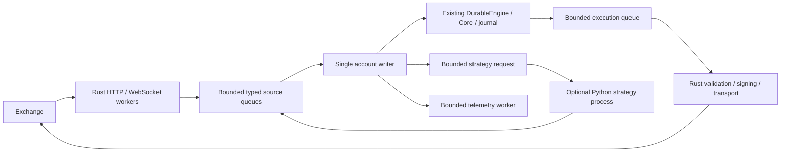

# Rust native live runtime: migration and evidence proposal v1.0

Created: 2026-10-15T03:33:00+09:00 (Asia/Tokyo).
Status: implementation authorized by the owner; architecture and evidence gates frozen before candidate work.
Baseline: `4b3e5c1`. This document supersedes the Python-coordinator choice for the new Hyperliquid runtime, not existing journal or Core guarantees.

## 1. Goal and reason

The project goal is Rust trading infrastructure from market ingestion through routing, risk/OMS and execution, with Python as an optional strategy/research boundary. Reliability alone does not justify Rust. Previous work established a useful deterministic Core and fault evidence, but the live Python coordinator remained responsible for ingestion and dispatch. This migration corrects that ownership and measures the resulting complete local path.

Exchange reports are authoritative observations of venue facts, not an instantaneous complete account view. Local durable intent, reserved exposure and uncertainty remain authoritative records of what this system authorized. No REST absence response or timeout proves a mutation never happened.

Deliver two independent verdicts: architecture/correctness acceptance, and measured performance acceptance. A Rust implementation, a fast parser, a passing soak or a small Core benchmark alone never proves end-to-end improvement.

## 2. Scope

Required implementation:

- Native Rust Hyperliquid Testnet public REST/WebSocket ingestion, account/execution REST, signing, action nonce journal, conservative account admission and reconciliation.
- Native bounded routing and one writer owning existing `DurableEngine` directly. Live market and execution events do not travel through the Python bridge.
- Explicit source identity, event/receive times, freshness, session/epoch checks, overload gating, limited queues and shutdown handling.
- Optional isolated Python strategy receiving only bounded observations and returning versioned, expiring targets. Rust continues timers/private processing while strategy waits.
- Native deterministic diagnostic strategy for comparison and fault testing; label forced diagnostic orders separately from strategy orders.
- Existing backtests, Python reference runtimes and Binance contracts remain regression references. One dedicated account, native BTC perp, cross 1x, small Testnet-only orders.
- Timestamped machine-readable traces, resource measurements, manifests, AWS comparison and 15-minute live acceptance, original-session recovery and final flat check.

Out of scope: mainnet execution, multi-instrument shared collateral, PCA alpha deployment, new journal/checkpoint trust semantics, distributed exactly-once delivery, forced liquidation of uncertain exposure, a universal plugin bus, kernel bypass, production high availability. No claim of mature HFT readiness.

Do not spend the full session pursuing an inconclusive micro-optimization. Fix correctness failures first; keep unproven performance clearly unproven. Failures and incomplete runs must remain in the evidence inventory.

## 3. Architecture and stacks

- Rust stable, existing serde/serde_json and Core/journal. Add bounded channel and native HTTP/WebSocket dependencies only where needed. Tokio provides async network transport; application threads have explicit ownership, no thread-per-tick or process-per-feed.
- Native secp256k1/Keccak/EIP-712 plus MessagePack implement the documented Hyperliquid L1 signing shape. Verify bytes, hash and signature against the pinned official Python SDK using public disposable test keys before any real signature. Never implement cryptographic primitives ourselves.
- Exact Decimal financial arithmetic and checked integer tick/lot conversion. No floating point prices, amounts or accounting. Float durations are reporting only.
- Same-process typed events require no serialization. Keep JSON at external exchange and initial Python strategy boundary; do not introduce rkyv into the hot route merely because it offers archived access. Reconsider archived binary storage only after attribution proves a material bottleneck and version/validation requirements are specified.
- One I/O runtime with a small fixed worker count, one account writer, one serialized execution owner, one optional strategy worker and one bounded output worker. Freeze actual thread count/CPU allocation in each manifest. No busy spin by default.
- Strategy cache remains O(window), with rolling O(1) update. Runtime order history is session-bounded; this migration does not claim indefinite bounded history or enable unvalidated Hyperliquid rotation.

## 4. Required contracts

### Routing and overload

Use explicit typed point-to-point subscriptions, not global event broadcast. Preserve each source's order; record writer acceptance order rather than inventing a global venue sequence. Critical/control traffic has reserved capacity and bounded priority, with market fairness. Initial capacities: market 128, critical 32, external effects 32, strategy outstanding 1, telemetry 1024. Every in-flight item must be counted separately.

No implicit market coalescing. Critical overflow, malformed data, stale connection or unknown execution outcome closes admission. A host-visible latch prevents dispatch while the writer is occupied by durable I/O. A queued action that was never sent still has a durable intent; discarding it must not turn uncertainty into rejection. No unbounded tasks or replacement worker per timeout.

### Durability and ownership

Keep Core single-writer; no external mutable reference. Preserve prepare -> journal -> sync -> commit -> external effect. Use existing `outbox` semantics consistently in A/B. Do not put the recovery journal on the lossy telemetry queue. Action journal and account lock must protect cross-language local coexistence; a local lock is not a cross-host lease. Explicit operator exclusivity is still required across machines.

Every outgoing action records a stable cloid, nonce and expiry durably, without key/signature. No automatic mutation retry; unknown outcomes recover by original identity. Reuse original session/config/journals on restart. Refuse mismatch, corruption, unsupported histories or unproven absence.

### Account and venue

Preserve H1 restrictions: dedicated flat-genesis account, BTC only, cross 1x, target 0.0002 BTC, maximum order USD40, minimum equity USD100, maximum session loss USD10. Reversal orders may be 0.0004 BTC. Verify agent-to-account binding and supported account mode. Account/quote freshness, existing open orders and final admission are checked before signing. Public mainnet probes may be supported; mainnet signed actions cannot be enabled by a URL option.

Quiescent reconciliation cancels only owned orders, proves all known terminal quantities, paginates complete fills/funding, rejects changed duplicates and foreign activity, and checks independent USDC cash plus position. History caps or equal-timestamp saturation fail closed. Private streams may deliver observations; no subscription is treated as proof of recovery completeness.

### Strategy and time

Rust owns market/timer/private lifetime. Python receives a bounded observation/request with session, epoch, revision and deadline. Accept only matching, nonexpired results and recheck current risk. Strategy failure stops new strategy risk; it must not block private reports, cancellation, recovery or orderly shutdown. No full Core mirror or full historical fetch just to produce a signal.

Use a local monotonic clock for elapsed runtime and latency; retain exchange event time separately. Backtest uses virtual time. Python strategy and native diagnostic strategy are different workload modes and cannot be pooled into one speed claim.

### Hot/cold and shutdown

Telemetry may drop with explicit counters; orders/fills/journal may not silently drop. Delay cold worker intentionally during acceptance. Moving fsync to another thread does not remove the required durable wait. Allocations in formatting and queue admission must be included in attribution.

Stop source admission, quiesce execution, reconcile, optionally flatten only proven exposure, then independently query venue. SIGTERM should initiate a bounded orderly stop; SIGKILL/host loss can leave exposure. Persist evidence and use explicit original-session resume, never advertise automatic host-loss flattening. Signed acceptance ends with flat/no open orders, or an explicit unresolved incident and no further signed session.

## 5. Tasks, implementation steps and expected outputs

| Task | Why and steps | Output |
|---|---|---|
| RN0 contracts/evidence | Freeze this proposal, baseline SHA, clocks, workloads, metrics, hardware and resource budgets. Read-only AWS/account preflight. Build harness before candidate comparison. | Proposal, workload/experiment manifest, source/binary receipts |
| RN1 venue boundary | Port instrument conversion, nonce journal, signing and reconciliation as small functions/modules. Reuse H1 fixtures and add official signing vectors. Test negative cases before real orders. | Rust venue module, parity/fault tests, public REST/WS probe |
| RN2 Rust runtime | Directly own DurableEngine; typed bounded queues, source lifetimes, executor and admission latch. Add limits/stop evidence and replay mode before live execution. | Native binary and offline runtime traces |
| RN3 strategy boundary | Isolated Python worker with one outstanding request, bounded window and response validation. Test slow/crashed/stale worker while Rust handles private/control events. | Strategy worker/protocol and parity/isolation evidence |
| RN4 correctness/backtest | Replay same normalized total order and compare every state/effect; preserve old backtest APIs. Exercise uncertain-send, duplicate, cancel/fill race, overload and restart. | Full verify log, differential and failure reports |
| RN5 AWS evidence | Non-burstable benchmark host, A/A then interleaved A/B. Separate live Testnet acceptance from synthetic performance. Record hardware, storage, build and all failures. | Raw traces, comparison and 15-minute acceptance reports |
| RN6 handoff | Inspect final venue/account/process state; archive checksummed evidence in existing private S3; stop/delete temporary resources; publish code/docs. | Results with PASS/FAIL/INCONCLUSIVE/BLOCKED, resource cleanup receipt |

## 6. Quantitative acceptance

These are preregistered gates, not promises. An implementation failure is fixed without lowering thresholds; unavailable evidence is NOT_MEASURED or BLOCKED.

| ID | Gate |
|---|---|
| RN-A1 ownership | Native live invocation has zero Python coordinator/venue/signing processes. Optional Python process performs strategy only. All external effects originate after Rust durable processing. |
| RN-A2 invariants | Zero state/effect/position/reservation mismatches for the same normalized event total order; all existing tests pass, zero skipped/ignored tests used for coverage. Original replay position0/PnL12. |
| RN-A3 protocol | Official SDK signing vectors match action bytes/hash/signature for order/cancel, nonce and expiry variants; wrong network/account, malformed amounts, reused action and corrupted journal rejected 100%. No mainnet mutation. |
| RN-A4 faults | Before-send, lost-response, after-fill-before-report, duplicate/changed fill, cancel/fill race, stale strategy, queue overflow and restart scenarios each exercised deterministically. Zero blind resends, duplicate-accounted fills or false absence. Unknown states remain gated. |
| RN-A5 isolation | During a 1s strategy delay and 1s cold sink delay, no control/private event waits for the Python response or telemetry completion; queues stay within caps. Overload produces explicit gate/drop accounting, never silent critical loss. |
| RN-A6 live | Public REST+WS decoded; native Testnet long/flat/short/flat diagnostic with >=4 accepted orders and >=4 fills and recovery. Then >=900s paper/public session and >=900s signed session, duration excluding cleanup within ±5s, sampled combined RSS <=384MiB, terminal owned orders, final position0/open orders0. Controlled recovery included. |
| RN-A7 architecture compatibility | Existing Binance/Python commands and both interactive/precomputed-target backtests keep their existing contracts. No journal schema, trust contract or Core financial semantics change hidden in the runtime migration. |
| RN-P0 environment | Same AWS host, CPU affinity, filesystem, sync mode, compiler and workload. Five runs per side. A/A run-level p99 range <=20% of median for the primary metric; otherwise performance verdict INCONCLUSIVE. No overlapping CPU-intensive benchmark/soak jobs. |
| RN-P1 primary | Complete local receive-to-order-transport-handoff p99 improves >=10% with non-overlapping run-level ranges, on identical action-bearing workload and durability mode. Secondary no-order ingress-to-Core-complete has its own verdict; never substitute it for order latency. |
| RN-P2 guardrails | Compared with matched baseline: full-path p99.9, CPU/completed event and RSS must not regress >10%. Insufficient samples -> NOT_MEASURED; do not extrapolate p99.9 from a small live order sample. |
| RN-P3 absolute budget | Controlled replay at 1000 market messages/s: queue-wait p99 <=1ms; full local action-path p99 <=10ms with outbox durability on selected EBS. Budget includes signing/admission computation; separately label any simulated venue RPC waiting. Failure remains FAIL even if relative speed improves. |
| RN-P4 evidence accounting | Account for offered/admitted/completed/rejected/in-flight messages and all emitted actions. No closed-loop rate reduction masking overload. No sum of unrelated percentiles; record timestamps for the same event. |

Use >=100,000 retained completed observations per performance run where p99.9 is reported; order sample counts are independent and explicitly checked. Workload and time limits are frozen before executing candidates. If an action-bearing run has fewer than 100,000 samples, its p99.9 is NOT_MEASURED. Burst tests establish behavior/capacity, not a fabricated live feed rate.

### Workload matrix

1. Deterministic normalized Core events: exact correctness/reference comparison.
2. Recorded raw market messages: same decoder/routing/strategy mode at an open-loop scheduled rate, including normal and burst arrivals. Externally blocked waits are separately tagged.
3. Action-bearing local controlled venue: fixed acknowledgement/response schedule, identical financial inputs, same durability barrier. Trace actual dispatch boundary; signing uses a disposable public fixture key. No real exchange high-rate orders.
4. Strategy variants: native diagnostic and Python worker reported separately; never compare different strategy work under one headline.
5. Real Testnet: conservative order cap and small exposure; validates integration, accounting and recovery. It does not establish comparable market conditions for a latency A/B or enough p99.9 samples.

Instrumentation: t_receive, t_decoded, t_enqueued, t_writer_start, t_strategy_request/result (where applicable), t_core_prepare/commit, t_durable, t_execution_start, t_transport_handoff, t_response; source/session/epoch/correlation ID; bytes and queue depths. If HTTP-library instrumentation only exposes request start, label that proxy and do not claim socket handoff acceptance. Record process/thread CPU, allocations in separate diagnostic passes, RSS, context switches, scheduler/I/O samples and durable sync stage. Observation overhead must be reported.

## 7. AWS execution and cost controls

Use authorized Tokyo account/region and existing S3 artifact bucket. Prefer a temporary non-burstable 2-vCPU/4GiB instance for comparison, maximum 8h and USD5 task budget; verify price before creating. Use public subnet with no inbound ports, SSM, existing instance role, IMDSv2 and delete-on-termination EBS. No NAT Gateway, ALB, ECS cluster or paid endpoints. Use existing S3 gateway endpoint where available. Tag task/expiry and terminate after evidence upload; an existing small host is not a quiet performance reference.

Never place signing keys in source, CLI arguments, SSM command text, logs or ordinary S3 artifacts. AWS signed live execution requires an approved secure credential path; if unavailable, run AWS public/paper/offline evidence and report the signed AWS gate BLOCKED while completing local authorized Testnet validation. Do not weaken TLS or bypass the managed proxy. Temporary instance resource ownership and cleanup are explicit.

## 8. Results and change discipline

Retain failed A/A, failed tests, interrupted sessions and rejected optimizations. At most three optimization iterations against the frozen experiment. Architecture acceptance does not override performance FAIL. Compare against the frozen Python baseline, not only against an earlier Rust candidate. Publish exact commands, dependency versions, Git SHAs, binary hashes, manifest hashes, artifact index and limitations.

Future agents must report the actual ownership boundary, including every remaining Python dependency. Do not describe this as a complete multi-venue/HFT platform or as PCA-ready. If work is blocked, finish independent scope and leave exact commands/evidence for the missing gate.
